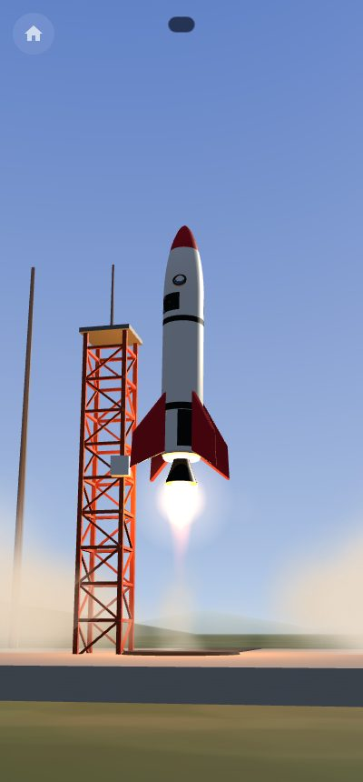
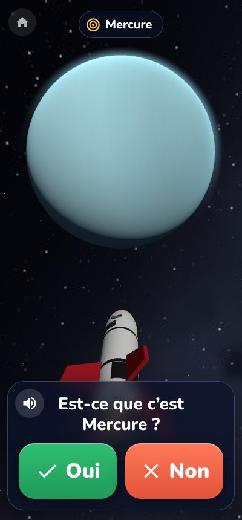

# Fusée Planètes 🚀

Un petit jeu Android pour voyager dans le système solaire, pensé pour une enfant
de 6 ans qui adore l’espace et reconnaît les planètes.

| Accueil | Destination | Décollage | Question | Victoire |
|---|---|---|---|---|
|  |  |  |  |  |

## Le déroulement d’une partie

1. **Choisir la destination** : Mercure, Vénus, Mars, Jupiter, Saturne, Uranus
   ou Neptune. Le nom de la planète est lu à voix haute quand on la touche.
2. **Le pas de tir** : la fusée attend sur son pas de tir, puis le **compte à
   rebours** est affiché en grand et compté à voix haute (10 ou 5 secondes).
3. **Le décollage** : flammes, fumée, le ciel bleu devient noir et les étoiles
   apparaissent.
4. **Le voyage** : la fusée s’approche d’une planète et une boîte de texte
   demande « Est-ce que c’est Saturne ? » avec deux gros boutons **Oui** / **Non**.
   * Si ce n’est pas la bonne planète, le jeu dit son nom et continue le voyage.
   * Le jeu continue jusqu’à arriver sur la bonne planète, puis la fusée se met
     en orbite autour d’elle.
5. **L’écran de victoire** montre le système solaire vu d’en haut et le
   **trajet de la Terre jusqu’à la planète** (sans les planètes croisées en route),
   avec des confettis et une petite anecdote sur la planète.

Les planètes déjà visitées reçoivent une étoile dorée dans le menu.

## Pour varier les parties

* **Des étoiles à gagner** : bonnes réponses, étoiles filantes, activités,
  photos… Le compteur ★ est toujours visible en haut de l’écran.
* **Des questions variées** : « Est-ce que c’est Saturne ? », mais aussi
  « Est-ce qu’elle a de grands anneaux ? », « Est-ce qu’elle est rouge ? »,
  et des devinettes en images de l’ordinateur de bord (« Laquelle est la plus
  grosse ? », « Trouve la Terre ! »). Une erreur n’est jamais punie : on
  réessaie jusqu’à trouver.
* **Des rencontres pendant le voyage** : étoiles filantes à attraper, station
  spatiale à qui faire coucou, petit vaisseau ami qui fait des pirouettes,
  comète, astéroïdes.
* **Une activité à l’arrivée** :
  * Mars : aider le robot à ramasser les cailloux qui brillent ;
  * Saturne : traverser les anneaux et attraper les cristaux de glace ;
  * la Lune : planter son drapeau (avec son prénom) et faire sauter l’astronaute ;
  * Jupiter, Neptune, Pluton : trouver la grande tache rouge, la tache sombre, le grand cœur ;
  * les autres : toucher la planète pour découvrir trois secrets.
* **Une photo souvenir** à chaque arrivée, rangée dans le carnet.
* **Mon carnet de bord** : un tampon par destination visitée (avec la date et le
  nombre de visites) et toutes les photos.
* **Nouvelles destinations** : après les 7 planètes, la Lune, Europe, Titan,
  Pluton et une comète se débloquent.
* **Ma fusée** : choisir la couleur de la fusée et des ailerons, son prénom
  peint dessus, et des décors (étoiles, cœurs, pois, planètes, arc-en-ciel,
  flammes) qui se débloquent avec les étoiles.

## Pensé pour le syndrome de Williams

* **Pas d’échec** : une mauvaise réponse n’est jamais punie. Le jeu corrige avec
  douceur (« Regarde bien… c’est Jupiter ! ») et donne un indice sur la planète
  cherchée (« Saturne a de magnifiques anneaux »).
* **Tout est lu à voix haute** (voix du téléphone). Le bouton 🔊 de la
  boîte de texte répète la question.
* **En français ou en anglais** : le jeu suit la langue du téléphone (français
  si le téléphone est en français, anglais sinon). On peut aussi la choisir
  dans les réglages.
* **Sons doux** : pas de bruit soudain ni fort (l’hyperacousie est fréquente). Le
  grondement du décollage monte progressivement. Le volume se règle.
* **Grands boutons**, toujours au même endroit (Oui à gauche en vert, Non à droite).
  Les écrans sont simples et il n’y a jamais de limite de temps.
* **Musique d’ambiance** très légère pendant le voyage.
* Le bouton retour d’Android ou la petite maison demandent une confirmation
  avant de quitter la partie, pour éviter les sorties par erreur.

## Réglages pour les parents

Roue dentée ⚙ en haut à droite de l’écran d’accueil :

* **Prénom** de l’enfant (« Bravo Léa ! »)
* **Langue / Language** : Auto (suit le téléphone), Français ou English
* Voix on/off, sons on/off, musique on/off, volume
* Compte à rebours de **5 ou 10**
* **Nombre de planètes à passer** avant la bonne : 0, 1, 2, 3 ou au hasard
* **Aide** : afficher l’image de la planète cherchée dans la question (pour
  commencer, ou si c’est trop difficile)

## Musiques et son du décollage

Le jeu peut jouer vos propres fichiers MP3 (sinon il garde ses sons de secours) :

* `web/musique/accueil.mp3`, `web/musique/voyage.mp3`, `web/musique/victoire.mp3`
  (prompts Suno prêts à copier : [docs/musique-suno.md](docs/musique-suno.md))
* `web/sons/decollage.mp3` : un vrai son de décollage

Pour les ajouter : sur GitHub, ouvrir le dossier `web/musique` (ou `web/sons`)
de la branche, *Add file → Upload files*, puis valider. GitHub fabrique
automatiquement un nouvel APK (2 à 3 minutes), à télécharger avec le même lien.
La musique baisse automatiquement quand la voix parle, et un réglage
« Musique » permet de la couper.

## Jouer dans le navigateur (sans rien installer, aussi sur iPhone)

Le jeu est aussi publié gratuitement en ligne avec GitHub Pages :
**https://gomgom51.github.io/Rocket-to-planet/**

* Il fonctionne sur Android (Chrome), iPhone et iPad (Safari) et sur ordinateur
  (Chrome, Edge, Firefox, Safari).
* Pour l’avoir comme une application, en plein écran : menu du navigateur →
  *Ajouter à l’écran d’accueil* (Chrome), ou bouton *Partager* →
  *Sur l’écran d’accueil* (Safari).
* Sur un téléphone, le jeu se joue en tenant le téléphone droit (un message le
  rappelle si on le tourne).
* La voix est celle du navigateur ; sur ordinateur, Edge et Chrome ont les plus
  belles voix.
* Il faut une connexion internet : environ 6 Mo sont téléchargés à l’ouverture,
  puis les musiques au fil de la partie. L’APK Android, lui, marche hors ligne.
* Les étoiles et les tampons sont gardés dans le navigateur (pas de compte,
  aucune donnée envoyée).

Le site est mis à jour automatiquement à chaque modification du dossier `web/`
(`.github/workflows/pages.yml`). Il faut l’activer une seule fois dans le
dépôt : *Settings → Pages → Build and deployment → Source :* **GitHub Actions**.

## Installer l’application sur le téléphone Android

L’APK est fabriqué automatiquement par GitHub Actions à chaque modification.

1. Sur le téléphone, ouvrir ce lien pour télécharger la dernière version :
   **https://github.com/gomgom51/Rocket-to-planet/releases/latest/download/FuseePlanetes.apk**
   (ou la page [Releases](https://github.com/gomgom51/Rocket-to-planet/releases) du dépôt).
2. Ouvrir le fichier téléchargé. Android demande d’autoriser l’installation
   d’applications provenant de cette source (le navigateur ou « Fichiers ») :
   accepter, puis **Installer**.
3. L’icône **Fusée Planètes** apparaît dans les applications.

Pour mettre à jour, il suffit d’installer le nouvel APK par-dessus l’ancien :
les réglages et les étoiles des planètes visitées sont conservés.

Le jeu fonctionne **entièrement hors ligne** (aucune connexion, aucune
publicité, aucune donnée envoyée).

### Si la voix ne parle pas (ou pas dans la bonne langue)

Paramètres Android → *Accessibilité* (ou *Système → Langues*) → **Synthèse
vocale** : choisir le moteur Google et installer la voix **Français (France)**
(ou **English** pour jouer en anglais).

## Essayer dans un navigateur (ordinateur)

```bash
cd web
python3 -m http.server 8000
# puis ouvrir http://localhost:8000
```

## Compiler l’APK soi-même

Il faut le SDK Android (ou Android Studio) et Java 17 :

```bash
cd android
./gradlew assembleRelease
# APK : android/app/build/outputs/apk/release/app-release.apk
```

L’APK est signé avec une clé de *debug* fixe (`android/app/family-debug.keystore`,
mot de passe `android`) pour pouvoir mettre à jour l’application sans la
désinstaller. Ce n’est pas une clé adaptée à une publication sur le Play Store.

## Organisation du code

* `web/` : le jeu (HTML, CSS, JavaScript, moteur 3D three.js, textures).
  * `js/data.js` : les planètes et **toutes les phrases** du jeu en français
    (faciles à modifier).
  * `js/lang/en.js` : les mêmes phrases en anglais.
  * `js/i18n.js` : le choix de la langue (français ou anglais).
  * `js/scenes.js` : les scènes 3D (accueil, pas de tir, voyage, carte de victoire).
  * `js/encounters.js` : les rencontres pendant le voyage.
  * `js/activities.js` : les activités à l’arrivée (Mars, Saturne, la Lune).
  * `js/screens.js` : le carnet de bord et « Ma fusée ».
  * `js/progress.js` : les étoiles, tampons, photos et le style de la fusée.
  * `js/main.js` : le déroulement de la partie et les écrans.
  * `manifest-fr.webmanifest`, `manifest-en.webmanifest`, `icons/` : le nom et
    l’icône du jeu quand on l’ajoute à l’écran d’accueil depuis le navigateur.
* `android/` : la petite application Android qui affiche le jeu (WebView) et lui
  donne la voix (TextToSpeech, en français ou en anglais).
* `tools/` : scripts pour préparer les textures et les icônes (`make_icon.js`
  pour Android, `make_web_icons.py` pour la version navigateur).

## Crédits

* Textures des planètes : [Solar System Scope](https://www.solarsystemscope.com/textures/)
  (licence CC BY 4.0, d’après des données NASA). Terre : NASA Earth Observatory,
  *Blue Marble Next Generation* (domaine public). Lune : NASA Scientific
  Visualization Studio. Europe : USGS Astrogeology / NASA/JPL (domaine public).
  Titan : NASA/JPL-Caltech/Space Science Institute. Pluton : NASA/JHUAPL/SwRI.
  Récupérées via les paquets npm `astraeus` et `astraeus-data`. L’atmosphère de
  Vénus, les anneaux de Saturne, la comète et la Voie lactée sont générés par
  `tools/make_textures.py` et `tools/make_bonus_textures.py`.
* Moteur 3D : [three.js](https://threejs.org) (licence MIT).
* Police : [Nunito](https://fonts.google.com/specimen/Nunito) (SIL Open Font License).
* Musiques : créées avec Suno. Son du décollage : « Seamless rocket booster roar & crackle », freesound_community (Pixabay).
