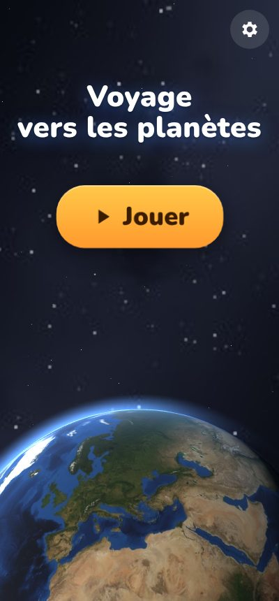
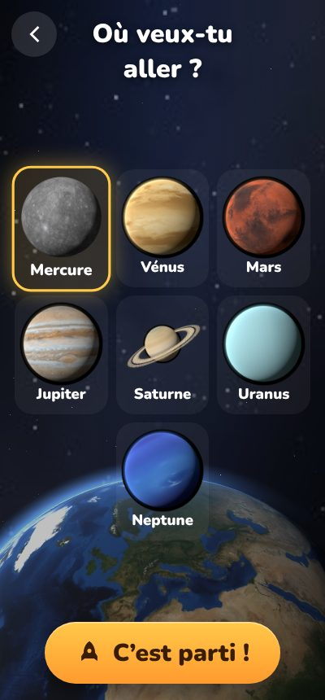
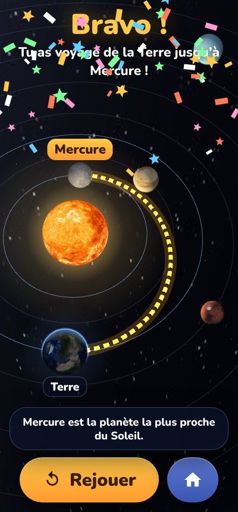

# Fusée Planètes 🚀

Un petit jeu Android pour voyager dans le système solaire, pensé pour une enfant
de 6 ans qui adore l’espace et reconnaît les planètes.

| Accueil | Destination | Décollage | Question | Victoire |
|---|---|---|---|---|
|  |  |  |  |  |

## Le déroulement d’une partie

1. **Choisir la destination** : Mercure, Vénus, Mars, Jupiter, Saturne, Uranus
   ou Neptune. Le nom de la planète est lu à voix haute quand on la touche.
2. **Le pas de tir** : la fusée attend sur son pas de tir, puis le **compte à
   rebours** est affiché en grand et compté à voix haute (10 ou 5 secondes).
3. **Le décollage** : flammes, fumée, le ciel bleu devient noir et les étoiles
   apparaissent.
4. **Le voyage** : la fusée s’approche d’une planète et une boîte de texte
   demande « Est-ce que c’est Saturne ? » avec deux gros boutons **Oui** / **Non**.
   * Si ce n’est pas la bonne planète, le jeu dit son nom et continue le voyage.
   * Le jeu continue jusqu’à arriver sur la bonne planète, puis la fusée se met
     en orbite autour d’elle.
5. **L’écran de victoire** montre le système solaire vu d’en haut et le
   **trajet de la Terre jusqu’à la planète** (sans les planètes croisées en route),
   avec des confettis et une petite anecdote sur la planète.

Les planètes déjà visitées reçoivent une étoile dorée dans le menu.

## Pensé pour le syndrome de Williams

* **Pas d’échec** : une mauvaise réponse n’est jamais punie. Le jeu corrige avec
  douceur (« Regarde bien… c’est Jupiter ! ») et donne un indice sur la planète
  cherchée (« Saturne a de magnifiques anneaux »).
* **Tout est lu à voix haute** (voix française du téléphone). Le bouton 🔊 de la
  boîte de texte répète la question.
* **Sons doux** : pas de bruit soudain ni fort (l’hyperacousie est fréquente). Le
  grondement du décollage monte progressivement. Le volume se règle.
* **Grands boutons**, toujours au même endroit (Oui à gauche en vert, Non à droite).
  Les écrans sont simples et il n’y a jamais de limite de temps.
* **Musique d’ambiance** très légère pendant le voyage.
* Le bouton retour d’Android ou la petite maison demandent une confirmation
  avant de quitter la partie, pour éviter les sorties par erreur.

## Réglages pour les parents

Roue dentée ⚙ en haut à droite de l’écran d’accueil :

* **Prénom** de l’enfant (« Bravo Léa ! »)
* Voix on/off, sons on/off, musique on/off, volume
* Compte à rebours de **5 ou 10**
* **Nombre de planètes à passer** avant la bonne : 0, 1, 2, 3 ou au hasard
* **Aide** : afficher l’image de la planète cherchée dans la question (pour
  commencer, ou si c’est trop difficile)

## Musiques et son du décollage

Le jeu peut jouer vos propres fichiers MP3 (sinon il garde ses sons de secours) :

* `web/musique/accueil.mp3`, `web/musique/voyage.mp3`, `web/musique/victoire.mp3`
  (prompts Suno prêts à copier : [docs/musique-suno.md](docs/musique-suno.md))
* `web/sons/decollage.mp3` : un vrai son de décollage

Pour les ajouter : sur GitHub, ouvrir le dossier `web/musique` (ou `web/sons`)
de la branche, *Add file → Upload files*, puis valider. GitHub fabrique
automatiquement un nouvel APK (2 à 3 minutes), à télécharger avec le même lien.
La musique baisse automatiquement quand la voix parle, et un réglage
« Musique » permet de la couper.

## Installer l’application sur le téléphone Android

L’APK est fabriqué automatiquement par GitHub Actions à chaque modification.

1. Sur le téléphone, ouvrir ce lien pour télécharger la dernière version :
   **https://github.com/gomgom51/Rocket-to-planet/releases/latest/download/FuseePlanetes.apk**
   (ou la page [Releases](https://github.com/gomgom51/Rocket-to-planet/releases) du dépôt).
2. Ouvrir le fichier téléchargé. Android demande d’autoriser l’installation
   d’applications provenant de cette source (le navigateur ou « Fichiers ») :
   accepter, puis **Installer**.
3. L’icône **Fusée Planètes** apparaît dans les applications.

Pour mettre à jour, il suffit d’installer le nouvel APK par-dessus l’ancien :
les réglages et les étoiles des planètes visitées sont conservés.

Le jeu fonctionne **entièrement hors ligne** (aucune connexion, aucune
publicité, aucune donnée envoyée).

### Si la voix ne parle pas (ou pas en français)

Paramètres Android → *Accessibilité* (ou *Système → Langues*) → **Synthèse
vocale** : choisir le moteur Google et installer la voix **Français (France)**.

## Essayer dans un navigateur (ordinateur)

```bash
cd web
python3 -m http.server 8000
# puis ouvrir http://localhost:8000
```

## Compiler l’APK soi-même

Il faut le SDK Android (ou Android Studio) et Java 17 :

```bash
cd android
./gradlew assembleRelease
# APK : android/app/build/outputs/apk/release/app-release.apk
```

L’APK est signé avec une clé de *debug* fixe (`android/app/family-debug.keystore`,
mot de passe `android`) pour pouvoir mettre à jour l’application sans la
désinstaller. Ce n’est pas une clé adaptée à une publication sur le Play Store.

## Organisation du code

* `web/` : le jeu (HTML, CSS, JavaScript, moteur 3D three.js, textures).
  * `js/data.js` : les planètes et **toutes les phrases** du jeu (faciles à modifier).
  * `js/scenes.js` : les scènes 3D (accueil, pas de tir, voyage, carte de victoire).
  * `js/main.js` : le déroulement de la partie et les écrans.
* `android/` : la petite application Android qui affiche le jeu (WebView) et lui
  donne la voix française (TextToSpeech).
* `tools/` : scripts pour préparer les textures et l’icône.

## Crédits

* Textures des planètes : [Solar System Scope](https://www.solarsystemscope.com/textures/)
  (licence CC BY 4.0, d’après des données NASA). Terre : NASA Earth Observatory,
  *Blue Marble Next Generation* (domaine public). Récupérées via le paquet npm
  `astraeus`. L’atmosphère de Vénus, les anneaux de Saturne et la Voie lactée sont
  générés par `tools/make_textures.py`.
* Moteur 3D : [three.js](https://threejs.org) (licence MIT).
* Police : [Nunito](https://fonts.google.com/specimen/Nunito) (SIL Open Font License).
* Musiques : créées avec Suno. Son du décollage : « Seamless rocket booster roar & crackle », freesound_community (Pixabay).
